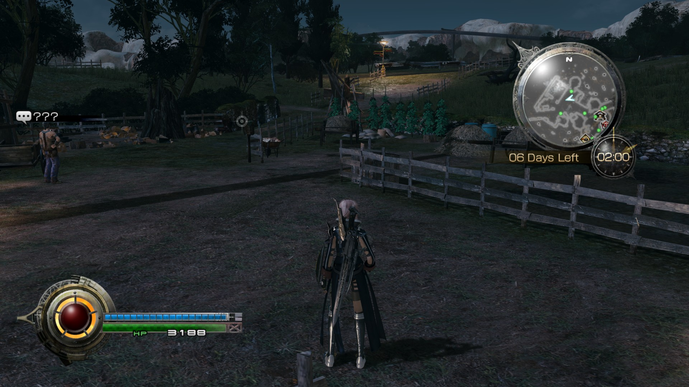
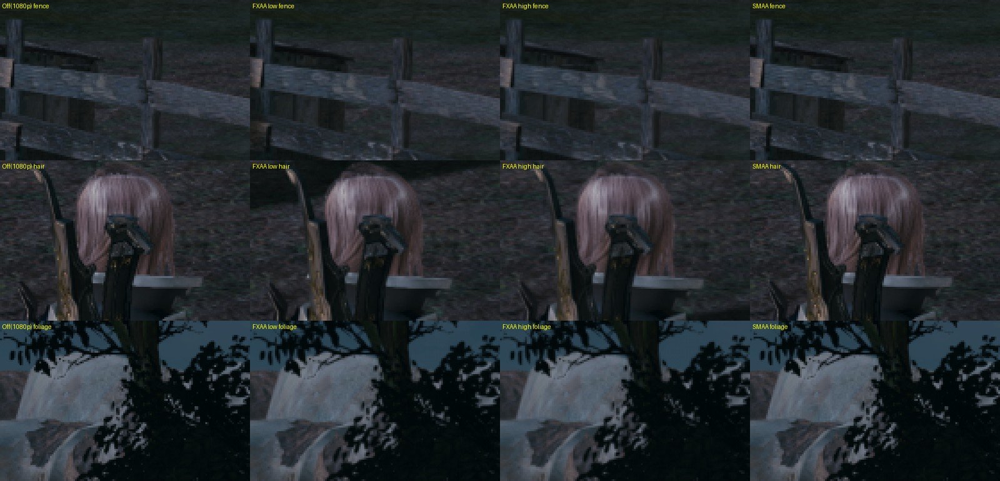
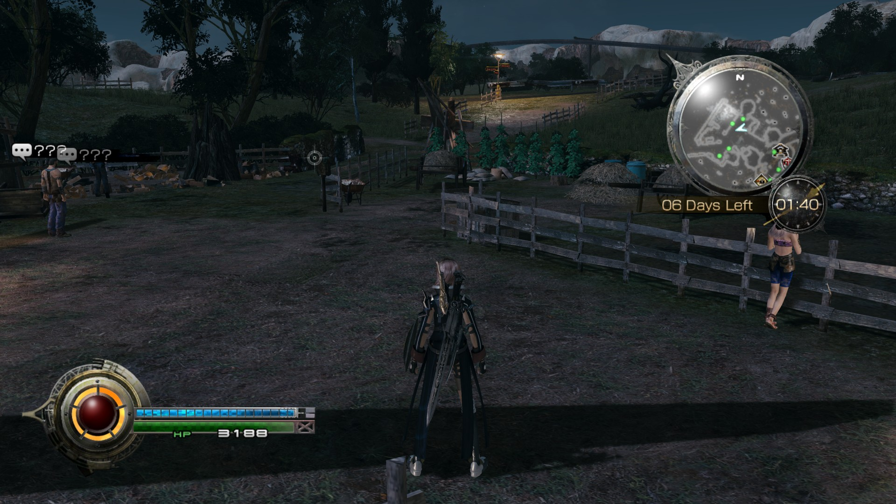

# Lightning Returns Recompiled

**Thank you, ps4star.** This project stands on his work. ps4star wrote the
[XRC translator](https://github.com/ps4star/XRC) that turns the game's x86 code into C, and the original runtime and launcher that
this repository builds on, first for his own Final Fantasy XIII port,
[WhiteRecomp](https://github.com/ps4star/WhiteRecomp). Without his translator and his runtime design none of this would exist,
and he generously allowed this runtime to be released. See [CREDITS.md](CREDITS.md).

A native 64-bit PC port of LIGHTNING RETURNS: FINAL FANTASY XIII for Windows, built from **your own Steam copy** of the game.
The game's executable is statically recompiled to C by XRC and runs on this runtime, with a Vulkan renderer for the game's Direct3D 9
calls.

**This repository contains no game files and no game code.** The translated C pages, tables, shaders, textures, movies and saves are
generated on your machine from your install and are never committed. You need a legally bought copy. Not affiliated with or
endorsed by Square Enix.



## What this adds on top of the translator and the original runtime

- **SMAA** (default), FXAA at three levels, or no anti-aliasing. Real captures, off / FXAA low / FXAA high / SMAA:
  
- **Shadow fixes.** Shadow stability (stops the pop-in from frame-to-frame visibility flicker) and a shadow-map fix for the far ground
  going dark in blocks. `XRC_POP_ZSHADOW` picks the shadow-map behavior: `keep` (default), `drop` or `old`.
  
- **Frame-pacing fix** and a steadier frame limiter (the game's 20 ms vblank spin is replaced by one precise wait), 60 fps gameplay.
- **F10 menu.** An in-game overlay that edits `lr.cfg` and applies most options at once: render resolution, display scaling, anti-aliasing,
  sharpening (contrast-adaptive sharpening), Lanczos supersampling, debanding, texture sharpness, HD textures, HD UI and fonts, HD cinematics,
  shadow stability, free camera and more.
  
- **Math speedups.** Native replacements for the hottest matrix, vector, quaternion and CRT math helpers
  (`src/runtime/ovr_math.c`, with a table generated from your own translated pages by `tools/ovr_math/gen_ovr_math.py`).
- **Faster loading** (file I/O and load-path work).
- **Typed structs and naming.** The runtime's guest-memory accesses use named, size-checked structs (`src/runtime/guest_types.h`,
  about 100 structs with compile-time offset checks) instead of raw offsets, and `tools/names` plus `docs/` hold the naming work on the
  game's functions and data. Converted files compile to the same machine code as the raw versions.
- A launcher (`launcher/`, Odin) that starts `lr.exe` and edits `lr.cfg` (play, graphics, saves and HD cinematics tabs), based on
  ps4star's WhiteRecomp launcher.
- Optional HD movies and textures through the scripts in `tools/upscale` (you run them on your own files).

## Build

Requirements: Windows 10/11 x64, your Steam copy of the game, [llvm-mingw](https://github.com/mstorsjo/llvm-mingw), Python 3, the
[Vulkan headers](https://github.com/KhronosGroup/Vulkan-Headers), a shared LGPL build of [FFmpeg](https://ffmpeg.org/), the
[Odin compiler](https://odin-lang.org/) (translator and launcher), and Valve's `steam_api64.dll` (copy it from your Steam install).

1. **Get the translator.** [ps4star/XRC](https://github.com/ps4star/XRC) (The Unlicense). Clone it, apply `patches/odin-rexcode-i386.patch`
   from that repo to Odin's `core:rexcode`, and build:
   `odin build src -out:xrc.exe -o:speed -extra-linker-flags:/STACK:16777216`.
   `patches/README.md` lists what the public translator still needs for this game (x87 handling and a few function-map additions;
   the patch for those is not published yet).
2. **Translate your own executable.** Copy the game's unpacked `LRFF13.exe` into a work folder, give XRC a function map and `xrc.cfg` for
   it, and run it. It writes `page_*.c` and `xrc_table.c`. The generated files stay in the work folder.
3. **Generate the math overrides, build the runtime and link:**
   ```
   LR_GEN=<translator output dir> python tools/ovr_math/gen_ovr_math.py
   LR_GEN=<translator output dir> FFMPEG=<ffmpeg dir> VULKAN_HEADERS=<vulkan-headers dir> \
   LLVM_MINGW=<llvm-mingw dir> sh build/build.sh
   ```
   `gen_ovr_math.py` writes `src/runtime/ovr_math_gen.inc` from your pages. Output is `out/lr.exe`.
4. **Run:** put `lr.exe`, the FFmpeg DLLs and `steam_api64.dll` next to the game's data (or point the runtime at it) and start it with
   Steam running. Build the launcher with `launcher/build.ps1` (set `ODIN` if `odin` is not on your PATH).

Environment variables used by the helper scripts: `LR_GEN` (translator output), `LR_ROOT` (work folder for the name tools), `LR_GAME_DIR`
(your game install, texture extraction), `TEXCONV`, `SEEDVR2_DIR`, `GLSLANG`.

## Credits

- **ps4star** wrote the XRC translator and the original runtime and launcher this builds on, and WhiteRecomp. Thank you.
  [XRC](https://github.com/ps4star/XRC), [WhiteRecomp](https://github.com/ps4star/WhiteRecomp).
- SMAA by Jorge Jimenez et al., stb_truetype by Sean Barrett, FXAA by Timothy Lottes (NVIDIA), FidelityFX CAS by AMD, and the fonts in the
  launcher. See [CREDITS.md](CREDITS.md) and [THIRD_PARTY.md](THIRD_PARTY.md).

## License

[The Unlicense](UNLICENSE) (public domain), the same license as ps4star's XRC. It covers the code in this repository. Bundled third-party
files keep their own licenses, listed in [THIRD_PARTY.md](THIRD_PARTY.md). The game itself belongs to Square Enix and is not included.
