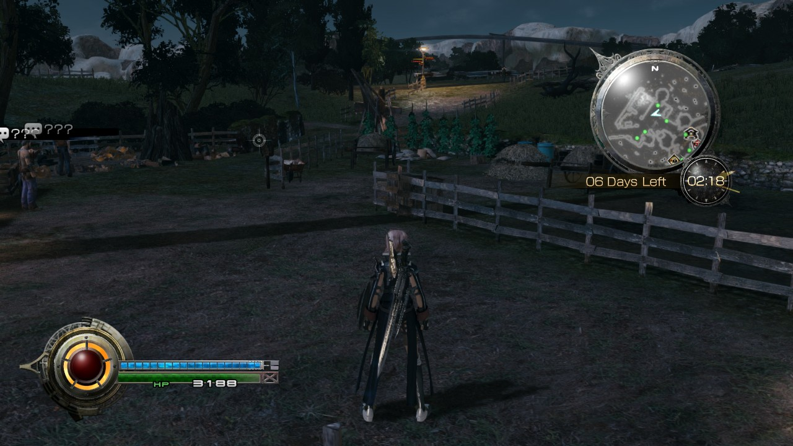

# Lightning Returns Recompiled

**Thank you, ps4star.** This project stands on his work. ps4star wrote the
[XRC translator](https://github.com/ps4star/XRC) that turns the game's x86 code into C, and the original runtime and launcher that
this repository builds on, first for his own Final Fantasy XIII port,
[WhiteRecomp](https://github.com/ps4star/WhiteRecomp). Without his translator and his runtime design none of this would exist,
and he generously allowed this runtime to be released. See [CREDITS.md](CREDITS.md).

A native 64-bit PC port of LIGHTNING RETURNS: FINAL FANTASY XIII for Windows, built from **your own Steam copy** of the game.
The game's executable is statically recompiled to C by XRC and runs on this runtime, with a Vulkan renderer for the game's Direct3D 9
calls.

**This repository contains no game files and no game code.** The translated C pages, tables, shaders, textures, movies and saves are
generated on your machine from your install and are never committed. You need a legally bought copy. Not affiliated with or
endorsed by Square Enix.


## What this adds on top of the translator and the original runtime

- **SMAA** (default), FXAA at three levels, or no anti-aliasing. Real captures, off / FXAA low / FXAA high / SMAA:
  
- **Shadow fixes.** Shadow stability (stops the pop-in from frame-to-frame visibility flicker) and a shadow-map fix for the far ground
  going dark in blocks. `XRC_POP_ZSHADOW` picks the shadow-map behavior: `keep` (default), `drop` or `old`.
  
- **Frame-pacing fix** and a steadier frame limiter (the game's 20 ms vblank spin is replaced by one precise wait), 60 fps gameplay.
- **F10 menu.** An in-game overlay that edits `lr.cfg` and applies most options at once: render resolution, display scaling, anti-aliasing,
  sharpening (contrast-adaptive sharpening), Lanczos supersampling, debanding, texture sharpness, HD textures, HD UI and fonts, HD cinematics,
  shadow stability, free camera and more.
  
- **Math speedups.** Native replacements for the hottest matrix, vector, quaternion and CRT math helpers
  (`src/runtime/ovr_math.c`, with a table generated from your own translated pages by `tools/ovr_math/gen_ovr_math.py`).
- **Faster loading** (file I/O and load-path work).
- **Typed structs and naming.** The runtime's guest-memory accesses use named, size-checked structs (`src/runtime/guest_types.h`,
  about 100 structs with compile-time offset checks) instead of raw offsets, and `tools/names` plus `docs/` hold the naming work on the
  game's functions and data. Converted files compile to the same machine code as the raw versions.
- A launcher (`launcher/`, Odin) that starts `lr.exe` and edits `lr.cfg` (play, graphics, saves and HD cinematics tabs), based on
  ps4star's WhiteRecomp launcher.
- Optional HD movies and textures through the scripts in `tools/upscale` (you run them on your own files).

## Build

One command builds `lr.exe` from your own Steam copy of the game. Nothing game-derived is stored in this repository: the translator
reads your `LRFF13.exe` (read only) and writes the C pages into `build/_work`, which git ignores.

```
python build/build_all.py --game "C:\Program Files (x86)\Steam\steamapps\common\LIGHTNING RETURNS FINAL FANTASY XIII"
```

The output folder (`out/`, change it with `--out`) gets `lr.exe`, the FFmpeg DLLs, `steam_api64.dll` and `BUILD_INFO.txt`.

What the script does, in order:

1. Checks `LRFF13.exe` against the SHA-256 of the current Steam build, `31a2bc59d305075f0e8eacee4f65f413a3205186b52b786d9f3a9db8aec1cf93`
   (34,003,456 bytes, no DRM). Another build is refused: the function map in `translator/lr/` is made for exactly this file. If yours
   differs, verify the game files in Steam first.
2. Finds the toolchain, or downloads it into `build/_deps` (see below).
3. Clones [ps4star/XRC](https://github.com/ps4star/XRC) at the pinned commit `0fdf2205623b8c9aa9fb3e6822f3508cefc677cd`, applies
   `patches/xrc-lr.patch` (our x87 changes) and builds it with Odin.
4. Translates your exe to C with `translator/lr/` (function map, overrides, config: addresses and sizes only, see
   [translator/lr/README.md](translator/lr/README.md)).
5. Generates `ovr_math_gen.inc` from your translated pages (`tools/ovr_math/gen_ovr_math.py`), compiles the runtime in `src/` and the
   158 pages with clang, and links.

A first build took about 15 minutes with 3 parallel compiles on a 16-core PC (one page alone can take 5 to 11 minutes, so expect up to an
hour on 4 cores) and needs about 3 GB in `build/_work`. Compiles run at
below-normal priority; `--jobs N` sets how many run at once (default 4). A second run redoes only what changed.

### What you need

- Windows 10/11 x64, your Steam copy of the game, [Python 3](https://www.python.org/downloads/) and
  [Git](https://git-scm.com/download/win) (`winget install Python.Python.3.12 Git.Git`).
- A C compiler: [llvm-mingw](https://github.com/mstorsjo/llvm-mingw), the UCRT x86-64 build, which supplies clang, the MinGW headers and
  pthreads. MSVC's `cl` and LLVM's own Windows clang cannot build it. `winget install MartinStorsjo.LLVM-MinGW.UCRT` (per user), or
  let the script download it, or pass `--llvm-mingw <dir>`. (ps4star's WhiteRecomp launcher gets its compiler the same way.)
- To build the translator: the [Odin](https://odin-lang.org/) compiler (release `dev-2026-11`) and the Windows SDK plus MSVC libraries
  that Odin links against: Visual Studio Build Tools with the "Desktop development with C++" workload
  (`winget install Microsoft.VisualStudio.2022.BuildTools --override "--add Microsoft.VisualStudio.Workload.VCTools --includeRecommended --passive"`).
  Odin is downloaded for you; the Build Tools are not. Pass `--xrc <prebuilt xrc.exe>` to skip this part.
- A shared LGPL build of FFmpeg 9.0 with headers (BtbN's `win64-lgpl-shared`) and the
  [Vulkan headers](https://github.com/KhronosGroup/Vulkan-Headers) (v1.4.330). Both are downloaded when missing, or pass `--ffmpeg <dir>`
  and `--vulkan-headers <dir>`.
- Valve's 64-bit `steam_api64.dll`. The script copies it from any 64-bit game in your Steam library, or pass `--steam-api <file>`.

`python build/build_all.py --help` lists every option (`--no-download`, `--march x86-64-v3` for an exe you will copy to another PC,
`--launcher` to build the launcher too, `--stop-after translate|compile`). The same locations can come from the environment variables
`LLVM_MINGW`, `FFMPEG`, `VULKAN_HEADERS` and `ODIN`.

### Run

Put the game's data (`weiss_data` and the other files from your install) beside `lr.exe`, or point the runtime at it, and start it with
Steam running. The launcher builds with `--launcher` or `launcher/build.ps1` (set `ODIN` if `odin` is not on your PATH).

Environment variables used by the helper scripts: `LR_GEN` (translator output, for `gen_ovr_math.py`), `LR_ROOT` (work folder for the name
tools), `LR_GAME_DIR` (your game install, texture extraction), `TEXCONV`, `SEEDVR2_DIR`, `GLSLANG`.

## Credits

- **ps4star** wrote the XRC translator and the original runtime and launcher this builds on, and WhiteRecomp. Thank you.
  [XRC](https://github.com/ps4star/XRC), [WhiteRecomp](https://github.com/ps4star/WhiteRecomp).
- SMAA by Jorge Jimenez et al., stb_truetype by Sean Barrett, FXAA by Timothy Lottes (NVIDIA), FidelityFX CAS by AMD, and the fonts in the
  launcher. See [CREDITS.md](CREDITS.md) and [THIRD_PARTY.md](THIRD_PARTY.md).

## License

[The Unlicense](UNLICENSE) (public domain), the same license as ps4star's XRC. It covers the code in this repository. Bundled third-party
files keep their own licenses, listed in [THIRD_PARTY.md](THIRD_PARTY.md). The game itself belongs to Square Enix and is not included.
